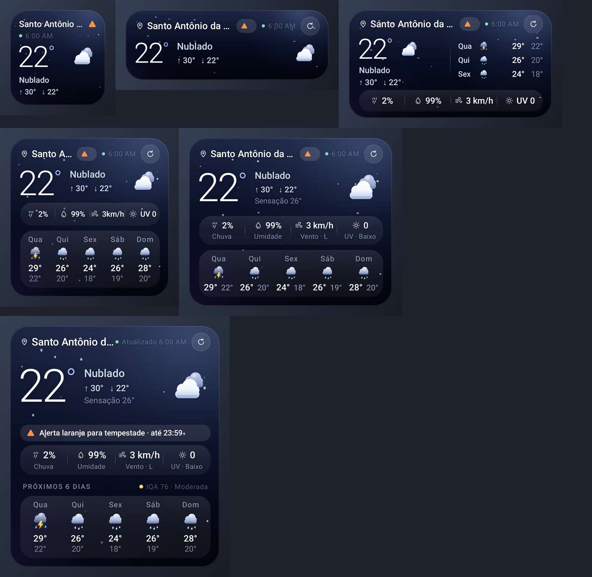
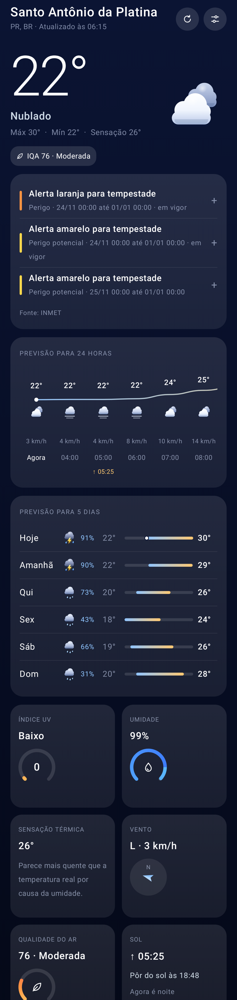

# Tempo: Premium Atmospheric Weather

Widget de previsão do tempo para Android (tela inicial), com dados reais da [Open-Meteo](https://open-meteo.com) e avisos oficiais do [INMET](https://alertas2.inmet.gov.br), e identidade visual **Premium Atmospheric Weather 2.0**: azul-marinho profundo, luz ambiente por condição climática, superfícies translúcidas sem contorno e ícones vetoriais com volume.

## Funcionalidades

| | |
|---|---|
| **Clima atual** | Temperatura em destaque, cidade/UF, condição, máx/mín, sensação térmica e ícone ilustrado |
| **Indicadores** | Chuva, umidade, vento (com direção) e índice UV, com ícone, valor e rótulo discreto |
| **Previsão** | 5 dias no widget; 24 horas (curva de temperatura, vento, nascer/pôr do sol) na tela detalhada |
| **Alertas do INMET** | Avisos oficiais cujo polígono cobre o local: chip/faixa no widget e cartões com riscos e recomendações |
| **Qualidade do ar** | IQA (escala US AQI), PM2,5 e PM10 |
| **Fundos fotográficos** | Cenário por período do dia (madrugada, manhã, tarde, entardecer, noite, no fuso da cidade) × condição (limpo, parcial, nublado, nevoeiro, chuva fraca/moderada/intensa, tempestade, granizo, neve), com véu azul-marinho para legibilidade e troca em fade. Ver `tools/scenes/SCENES.md` |
| **Atmosfera dinâmica** | Ensolarado, nublado, chuva, tempestade, noite e pôr do sol (pelo nascer/pôr do sol do local) |
| **Localização** | Automática (rede, fused e GPS, em sequência) ou cidade escolhida pela busca |
| **Atualização** | Automática (WorkManager, 30 min–3 h, só com rede), manual pelo botão, e ao trocar de cidade |
| **Offline** | Último dado válido persistido; falhas mostram `Offline · 14:32`, nunca valores inventados |
| **Interações** | Toque abre a previsão detalhada na seção tocada (alertas, 5 dias, indicadores); botão de atualizar |






## Arquitetura

```
app/src/main/java/app/tempo/weather/
├── data/
│   ├── OpenMeteoClient.kt     HTTP + parsing (previsão, 24 h, qualidade do ar e geocoding)
│   ├── InmetClient.kt         Avisos do INMET: filtro por polígono oficial (ponto-em-polígono)
│   ├── WeatherModels.kt       Snapshot imutável + serialização JSON para cache
│   ├── WeatherCondition.kt    Códigos WMO → condição, rótulo pt-BR e ícone
│   ├── WeatherRepository.kt   Resolve local → busca → persiste (nunca sobrescreve dado válido com falha)
│   └── WeatherStore.kt        SharedPreferences: preferências, último snapshot, estado por widget
├── location/DeviceLocator.kt  LocationManager (sem Play Services) + Geocoder do sistema
├── widget/
│   ├── Atmosphere.kt          Escolha da atmosfera (inclui dia/noite e "hora dourada" no fuso do local)
│   ├── WidgetRenderer.kt      Monta os RemoteViews por tamanho, formatação e crossfades
│   └── WeatherWidgetProvider.kt
├── work/WeatherUpdateWorker.kt  Atualização periódica e manual
├── ui/MainActivity.kt         Configuração em Compose com pré-visualização ao vivo do widget real
└── ui/DetailActivity.kt       Previsão detalhada (aberta pelo widget)
```

**Renderização:** o widget usa `RemoteViews` com layouts XML. No Android 12+ ele entrega um mapa `SizeF → RemoteViews`, então o launcher troca de layout sozinho ao redimensionar, sem acordar o app. Abaixo do Android 12, o layout é escolhido pelas opções de tamanho do widget.

| Variação | Mín. (dp) | Composição |
|---|---|---|
| `COMPACT` | — | local, horário, temperatura grande + ícone, condição, máx/mín (2×2) |
| `MEDIUM_SHORT` | 220×0 | cabeçalho + clima atual em linha (4×1) |
| `MEDIUM_NARROW` / `MEDIUM` | 220×150 / 280×150 | clima atual à esquerda, resumo de 3 dias à direita, faixa de indicadores (4×2) |
| `EXPANDED_NARROW` / `EXPANDED` | 250×250 / 300×250 | clima atual, indicadores com rótulos e previsão de 5 dias (4×3) |
| `LARGE` | 300×330 | tudo em escala maior, faixa do alerta INMET e linha de IQA (4×4) |

## Limitações da plataforma e como foram tratadas

- **Fotos locais, sem download:** as fotos ficam no próprio APK (WebP 1280×720 em `drawable-nodpi`) e o launcher as carrega direto dos recursos. Não há download, cache para invalidar nem limite de bitmap do RemoteViews, e tudo funciona offline. Por isso "pré-carregar" e "evitar downloads repetidos" ficam resolvidos por construção. A troca só acontece quando a chave do cenário muda. Um alarme RTC (que não acorda o aparelho) redesenha o widget na virada de período. Abaixo do Android 12 o launcher não recorta a foto nos cantos, então nesses aparelhos o widget usa o degradê.

- **Sem animações contínuas.** A atmosfera usa camadas estáticas (estrelas, chuva, névoa, luz), assim o launcher não precisa redesenhar o widget a cada quadro. O único elemento animado é o indicador de carregamento, que só aparece durante uma atualização.
- **Transições sem salto de layout:** temperatura, ícone e fundo têm duas camadas sobrepostas (A/B). O valor novo entra na camada oculta e a visibilidade se inverte, e o `animateLayoutChanges` do container faz o crossfade. O estado de cada camada é salvo por widget, com chaves estáveis em vez de IDs de recurso.
- **Bateria e dados:** sem `updatePeriodMillis`. O WorkManager agenda as atualizações com restrição de rede e respeita o Doze. A localização é aproximada. O feed nacional do INMET tem cerca de 400 KB e não vem comprimido, então é consultado no máximo a cada 2 h (ou ao atualizar manualmente ou trocar de cidade). Se ele ou a qualidade do ar falharem, a previsão continua e o último valor válido do mesmo local é mantido.
- **Localização em segundo plano:** no Android 10+ ela exige a permissão "o tempo todo". Sem essa permissão, o widget usa a última posição obtida com o app aberto, e o app explica isso e oferece o atalho para a permissão.
- **Fontes:** `RemoteViews` não aceita fontes de forma confiável em todos os launchers, por isso o widget usa as famílias do sistema (`sans-serif-light` / `-medium`), com números tabulares e espaçamento ajustado.
- **`<View>` puro é proibido em `RemoteViews`.** Os espaçadores são `FrameLayout`. O teste de renderização pegou esse problema.

## Compilar

Requer JDK 17+ e Android SDK (platform 36).

```bash
./gradlew assembleDebug        # app/build/outputs/apk/debug/app-debug.apk
./gradlew assembleRelease      # assinado com a chave de debug, troque antes de publicar
./gradlew testDebugUnitTest    # testes + renderizações em app/build/widget-renders/*.png
```

Instale o APK, abra o app **Tempo** para conceder a localização ou escolher uma cidade e adicione o widget **Tempo Atmosférico** na tela inicial.

## Testes

- `OpenMeteoParsingTest`: interpreta uma resposta real gravada da Open-Meteo (`src/test/resources/fixtures`), testa valores nulos, erros da API, geocoding, formatação (sinal de menos tipográfico, sem `-0`) e a escolha de tamanhos.
- `WidgetRenderTest`: infla os **layouts reais** do widget com Robolectric (gráficos nativos) em 10 tamanhos × 7 atmosferas e nos estados vazio, carregando, atualizando e offline. Grava PNGs e falha se algum texto visível sair dos limites do widget. As variações de atmosfera trocam o código WMO da resposta gravada **só no teste**, para exercitar os temas.
- `AlertsAndAirTest`: avisos do INMET gravados, filtrados pelo polígono oficial. Para Santo Antônio da Platina (PR) o resultado é alerta laranja de tempestade hoje e amarelo amanhã. Também cobre avisos expirados, locais fora do Brasil, IQA, 24 h, direção do vento e leitura do cache da versão anterior.
- `DetailScreenTest`: abre a previsão detalhada com dados reais gravados e salva uma captura.
- `LegacyRenderTest`: garante que todas as variações inflam no Android 10.

## Recursos de design

Fundos, ícones, camadas atmosféricas e layouts são gerados por scripts em `tools/design/` (`gen_bg.py`, `gen_icons.py`, `gen_avd.py` para camadas atmosféricas e carregamento, `gen_layouts.py`). Para ajustar a paleta ou a geometria, edite o script e regenere:

```bash
python3 tools/design/gen_icons.py app/src/main/res/drawable
python3 tools/design/gen_layouts.py app/src/main/res/layout
```

Dados meteorológicos: Open-Meteo.com, licença CC BY 4.0. Avisos: Instituto Nacional de Meteorologia (INMET).
