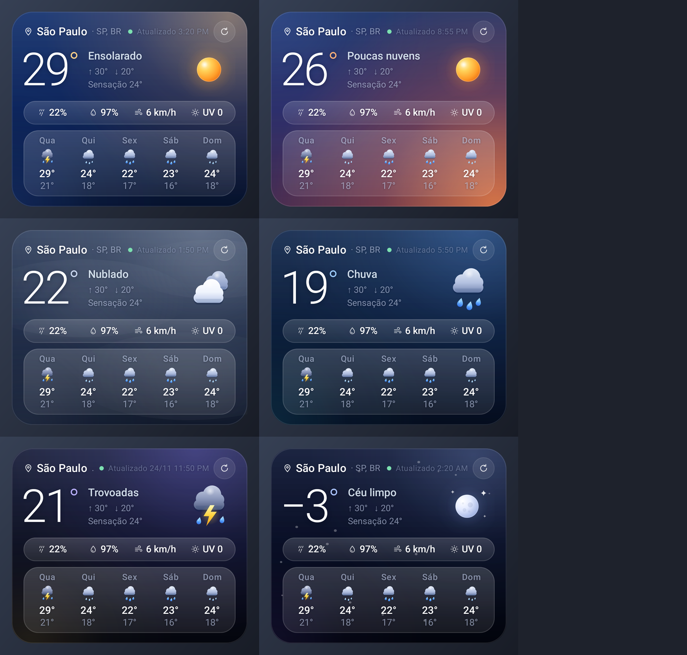
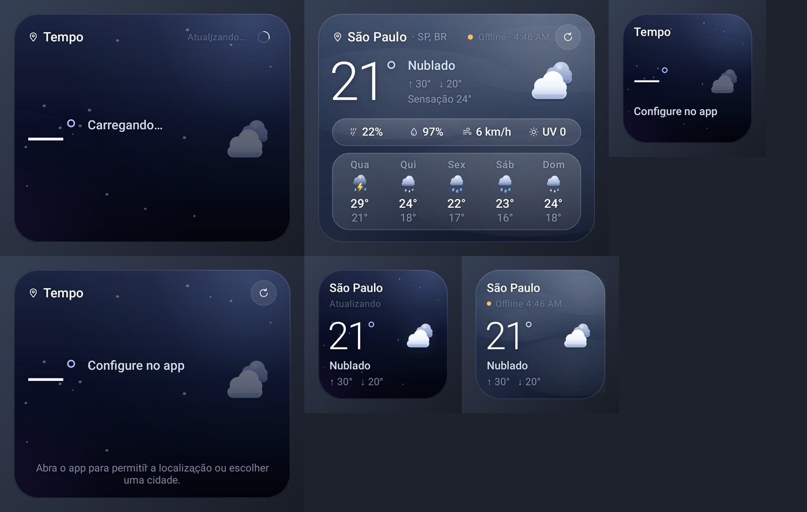

# Tempo: Premium Atmospheric Weather

Widget de previsão do tempo para Android (tela inicial), com dados reais da [Open-Meteo](https://open-meteo.com) e identidade visual **Premium Atmospheric Weather**: fundo azul-marinho profundo, luz ambiente por condição climática, painéis de vidro discretos e ícones vetoriais com volume.



## Funcionalidades

| | |
|---|---|
| **Clima atual** | Temperatura em destaque, cidade/UF, condição, máx/mín do dia, sensação térmica e ícone grande |
| **Indicadores** | Probabilidade de chuva, umidade, vento (km/h) e índice UV com classificação |
| **Próximos 5 dias** | Dia da semana, ícone, máxima e mínima |
| **Atmosfera dinâmica** | Ensolarado, nublado, chuva, tempestade, noite e pôr do sol (calculado pelo nascer/pôr do sol do local) |
| **Localização** | Automática (permissão aproximada) ou cidade escolhida manualmente pela busca da Open-Meteo |
| **Atualização** | Automática pelo WorkManager (30 min a 3 h, só com rede) e manual pelo botão do widget |
| **Offline** | O último dado válido fica salvo. Se uma atualização falhar, o widget mostra `Offline · 14:32` com indicador âmbar e nunca inventa valores |
| **Tamanhos** | 7 variações responsivas, de 2×2 até 4×4 ou maior (veja abaixo) |




## Arquitetura

```
app/src/main/java/app/tempo/weather/
├── data/
│   ├── OpenMeteoClient.kt     HTTP + parsing (forecast e geocoding), sem dependências externas
│   ├── WeatherModels.kt       Snapshot imutável + serialização JSON para cache
│   ├── WeatherCondition.kt    Códigos WMO → condição, rótulo pt-BR e ícone
│   ├── WeatherRepository.kt   Resolve local → busca → persiste (nunca sobrescreve dado válido com falha)
│   └── WeatherStore.kt        SharedPreferences: preferências, último snapshot, estado por widget
├── location/DeviceLocator.kt  LocationManager (sem Play Services) + Geocoder do sistema
├── widget/
│   ├── Atmosphere.kt          Escolha da atmosfera (inclui dia/noite e "hora dourada" no fuso do local)
│   ├── WidgetRenderer.kt      Monta os RemoteViews por tamanho, formatação e crossfades
│   └── WeatherWidgetProvider.kt
├── work/WeatherUpdateWorker.kt  Atualização periódica e manual
└── ui/MainActivity.kt         Configuração em Compose com pré-visualização ao vivo do widget real
```

**Renderização:** o widget usa `RemoteViews` com layouts XML. No Android 12+ ele entrega um mapa `SizeF → RemoteViews`, então o launcher troca de layout sozinho ao redimensionar, sem acordar o app. Abaixo do Android 12, o layout é escolhido pelas opções de tamanho do widget.

| Variação | Mín. (dp) | Conteúdo |
|---|---|---|
| `COMPACT` | — | temperatura, cidade, condição, máx/mín, horário |
| `MEDIUM_SHORT` | 220×0 | cabeçalho + clima atual (4×1) |
| `MEDIUM_NARROW` / `MEDIUM` | 220×150 / 280×150 | + indicadores (4×2) |
| `EXPANDED_NARROW` / `EXPANDED` | 250×250 / 300×250 | + previsão de 5 dias (4×3) |
| `LARGE` | 300×330 | tudo, em escala maior e com rótulos nos indicadores (4×4) |

## Limitações da plataforma e como foram tratadas

- **Widgets não executam código de animação.** As animações usam `AnimatedVectorDrawable` como drawable indeterminado de um `ProgressBar`. É a única forma de animar dentro de `RemoteViews`, e a animação roda na RenderThread do launcher sem acordar o app. Os efeitos: estrias de chuva, relâmpago sutil, estrelas cintilando com uma estrela cadente rara, névoa à deriva e halo solar que "respira".
- **Transições sem salto de layout:** temperatura, ícone e fundo têm duas camadas sobrepostas (A/B). O valor novo entra na camada oculta e a visibilidade se inverte, e o `animateLayoutChanges` do container faz o crossfade. O estado de cada camada é salvo por widget, com chaves estáveis em vez de IDs de recurso.
- **Bateria:** sem `updatePeriodMillis`. O WorkManager agenda as atualizações com restrição de rede e respeita o Doze. A localização é aproximada. As animações podem ser desligadas no app e se desligam sozinhas no modo de economia de bateria.
- **Localização em segundo plano:** no Android 10+ ela exige a permissão "o tempo todo". Sem essa permissão, o widget usa a última posição obtida com o app aberto, e o app explica isso e oferece o atalho para a permissão.
- **Fontes:** `RemoteViews` não aceita fontes de forma confiável em todos os launchers, por isso o widget usa as famílias do sistema (`sans-serif-light` / `-medium`), com números tabulares e espaçamento ajustado.
- **`<View>` puro é proibido em `RemoteViews`.** Os espaçadores são `FrameLayout`. O teste de renderização pegou esse problema.

## Compilar

Requer JDK 17+ e Android SDK (platform 36).

```bash
./gradlew assembleDebug        # app/build/outputs/apk/debug/app-debug.apk
./gradlew assembleRelease      # assinado com a chave de debug, troque antes de publicar
./gradlew testDebugUnitTest    # testes + renderizações em app/build/widget-renders/*.png
```

Instale o APK, abra o app **Tempo** para conceder a localização ou escolher uma cidade e adicione o widget **Tempo Atmosférico** na tela inicial.

## Testes

- `OpenMeteoParsingTest`: interpreta uma resposta real gravada da Open-Meteo (`src/test/resources/fixtures`), testa valores nulos, erros da API, geocoding, formatação (sinal de menos tipográfico, sem `-0`) e a escolha de tamanhos.
- `WidgetRenderTest`: infla os **layouts reais** do widget com Robolectric (gráficos nativos) em 10 tamanhos × 7 atmosferas e nos estados vazio, carregando, atualizando e offline. Grava PNGs e falha se algum texto visível sair dos limites do widget. As variações de atmosfera trocam o código WMO da resposta gravada **só no teste**, para exercitar os temas.
- `LegacyRenderTest`: garante que todas as variações inflam no Android 10.

## Recursos de design

Fundos, ícones, animações e layouts são gerados por scripts em `tools/design/` (`gen_bg.py`, `gen_icons.py`, `gen_avd.py`, `gen_layouts.py`). Para ajustar a paleta ou a geometria, edite o script e regenere:

```bash
python3 tools/design/gen_icons.py app/src/main/res/drawable
python3 tools/design/gen_layouts.py app/src/main/res/layout
```

Dados meteorológicos: Open-Meteo.com, licença CC BY 4.0.
